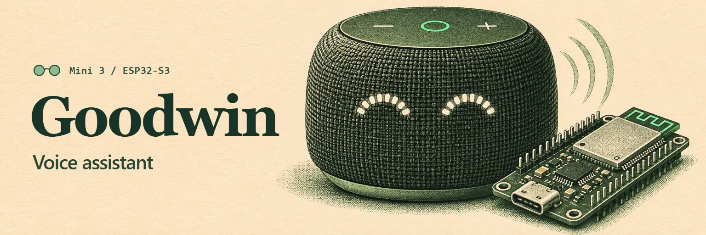
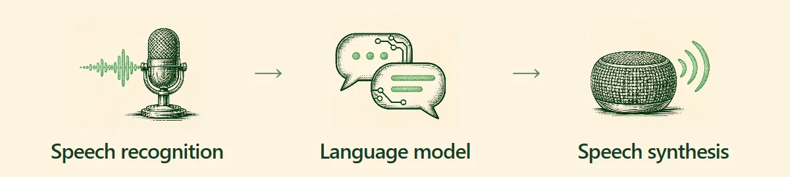
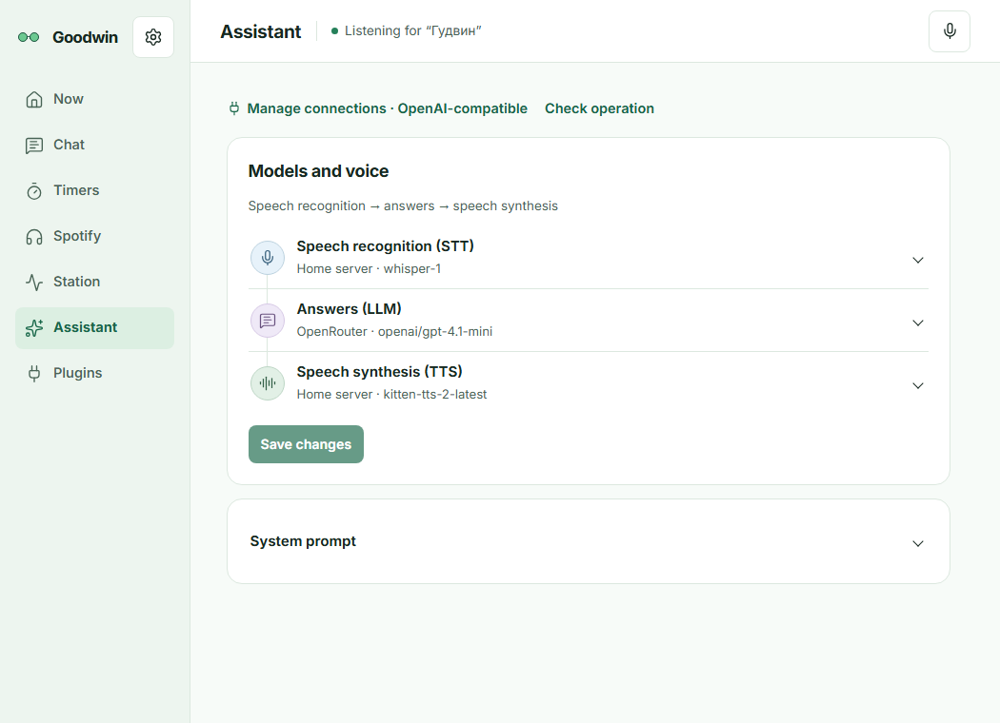

**English** · [Русский](README.ru.md)

# 

Goodwin is an open-source voice assistant for the **Yandex Station Mini 3** and for speakers you build with an **ESP32-S3**. The speaker detects its wake word locally and answers out loud using the models you choose. The default wake word is “Гудвин” (Goodwin). On the Mini 3, Alice still answers to her own name.

Ask why sunsets look red on Earth, then follow up with **“What about on Mars?”** Goodwin remembers the earlier exchange, so you can keep talking without repeating the wake word.

## Try Goodwin

- **On a Mini 3** — You'll need a prepared Station with root access over network ADB. Run the installer from Windows, Linux or macOS, then set a panel password and connect a provider. [Set up your Station](guides/mini-3.md#desktop-installer)
- **On an ESP32-S3** — Build a speaker with an N16R8 board, an I²S microphone and an amplifier. Activate it by voice or with a push-to-talk button. [Wiring and firmware](firmware/esp32s3/README.md)
- **On your computer** — Start the web panel on localhost to explore the interface or develop a plugin. [Run the panel locally](guides/development.md#run-the-panel-on-your-computer)

## Choose your models and voice

Under **Assistant languages** in the panel, choose the language you speak and the language Goodwin uses for voice and chat replies. Both default to Russian. For example, you can ask in English and get an answer in French if your models and chosen voice support those languages. To change the wake word itself, select or train a different wake-word model. [Wake-word guide](guides/wake-words.md)

In the Mini 3 panel, you can use a home server to transcribe your question, ask a model on OpenRouter for the answer and have KittenTTS read it aloud. Each stage has its own connection and model. Set a voice and speaking rate, or use a system prompt to give Goodwin a role and tone of its own. You can also type to the same chat model in your browser. [Configure providers](plugins/openai-compatible/README.md)

See these model settings in the Mini 3 panel

## Build on Goodwin

Use the Rust SDK to connect a new model provider, give the assistant a tool it can call or add a page to the panel. You can collect and label audio for a new wake word with the [Wake-word dataset plugin](plugins/wake-dataset/README.md). For an example of a plugin that exposes voice commands, see [Timers](plugins/timers/).

[Plugin SDK and examples](plugins/README.md) · [Wake-word training](guides/wake-words.md) · [Build and test](guides/development.md)

[Release notes](CHANGELOG.md)
