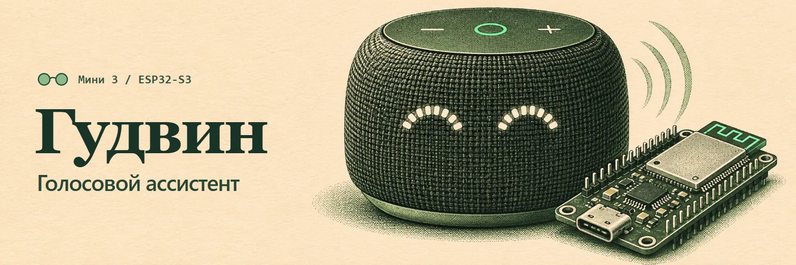
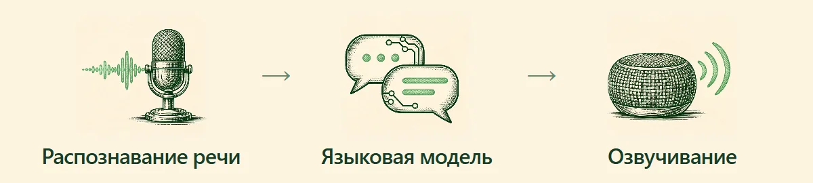
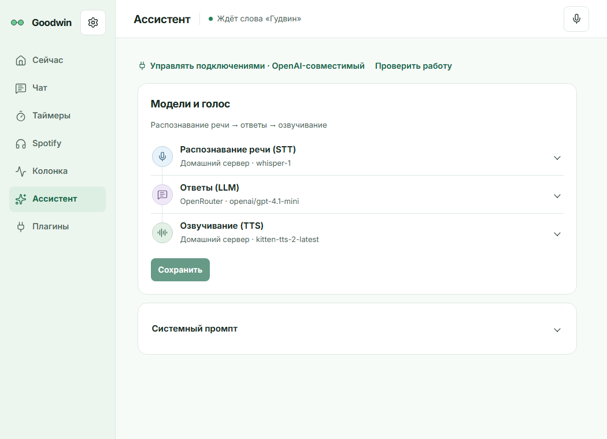

[English](README.md) · **Русский**

# 

Гудвин — голосовой ассистент с открытым исходным кодом для **Яндекс Станции Мини 3** и самодельных колонок на **ESP32-S3**. Колонка распознаёт слово активации локально, а какие модели разберут вопрос и ответят вслух — выбираете вы. По умолчанию колонка откликается на «Гудвин». На Мини 3 Алиса по-прежнему отзывается на своё имя.

Спросите «Гудвин, почему на Земле закат красный?» и после ответа уточните **«А на Марсе?»**. Гудвин помнит предыдущие реплики, поэтому можно продолжать разговор, не повторяя ни вопрос, ни слово активации.

## Попробовать Гудвина

- **На Мини 3** — понадобится подготовленная Станция с root-доступом по сетевому ADB. Запустите установщик на Windows, Linux или macOS, затем задайте пароль в панели и подключите провайдера. [Настроить Станцию](guides/mini-3.md#desktop-installer)
- **На ESP32-S3** — соберите колонку из платы N16R8, I²S-микрофона, усилителя и динамика. Начать разговор можно голосом или нажатием кнопки. [Схема подключения и прошивка](firmware/esp32s3/README.md)
- **На компьютере** — запустите веб-панель локально, чтобы посмотреть интерфейс или поработать над своим плагином. [Запуск панели](guides/development.md#run-the-panel-on-your-computer)

Панель открывается на экране **Сейчас**. В чате видны последние голосовые и текстовые реплики. Раскройте сообщение **Система**, чтобы посмотреть длительность этапов, действия плагинов и ошибки запроса. Переключатель **Системные сообщения** скрывает эти строки и запоминает выбор в браузере. Здесь же можно написать ответ или исправить и повторить последнюю голосовую команду. Активные таймеры и воспроизведение Spotify получают приоритет в сетке карточек. Закрепить плагин в меню можно через его действия в разделе **Плагины**.

## Выберите модели и голос

В разделе панели **«Языки ассистента»** можно выбрать, на каком языке вы говорите и на каком Гудвин отвечает вслух и в чате. По умолчанию оба языка — русский. Например, можно спрашивать по-английски и получать ответы по-французски, если модели и выбранный голос поддерживают эти языки. Чтобы колонка откликалась на другое имя, выберите или обучите отдельную модель активации. [О словах активации](guides/wake-words.md)

В панели Мини 3 можно поручить распознавание речи домашнему серверу, отправить текст вопроса модели в OpenRouter и озвучить ответ через KittenTTS. Для каждого этапа вы выбираете своё подключение и модель. Здесь же можно выбрать голос, настроить темп речи и задать характер ответов системным промптом. С той же моделью можно переписываться в браузере. [Настройка провайдеров](plugins/openai-compatible/README.md)

Посмотреть пример настройки моделей на Мини 3

## Разработка плагинов

С помощью SDK на Rust можно подключить новый сервис моделей, добавить голосовую команду или страницу в панель. В [плагине сбора записей](plugins/wake-dataset/README.md) можно разметить аудио, чтобы обучить колонку откликаться на новое имя. [Таймеры](plugins/timers/) — пример плагина с голосовыми командами.

[SDK и примеры плагинов](plugins/README.md) · [Обучение слову активации](guides/wake-words.md) · [Сборка и тесты](guides/development.md)

[История изменений](CHANGELOG.md)
